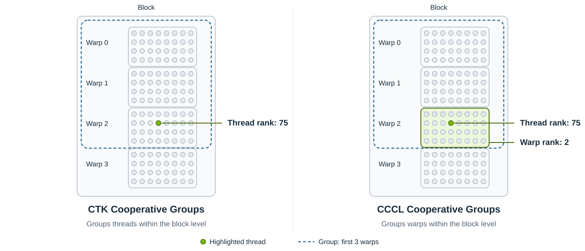
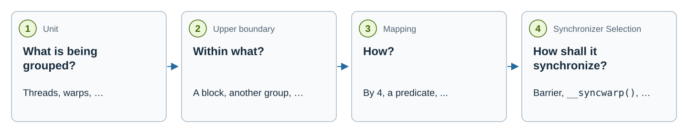

.. _cudax-coop-group:

CCCL Cooperative Groups
=======================

.. toctree::
  :maxdepth: 1

  mapping/index
  synchronizer/index
  this_group
  coalesced_group
  generic_group
  virtual_group
  group_view

CCCL Cooperative Groups are available through the ``<cuda/experimental/coop/group>`` header.

Introduction
------------

This section describes the fundamental ideas and features of CCCL Cooperative Groups and how they compare to CTK's Cooperative Groups.

Concerning Groups
^^^^^^^^^^^^^^^^^

Let's start with a quick introduction to groups regarding the CUDA programming model. A group could be simply defined as a collection of threads that must be able to synchronize, so they cooperate on solving algorithmic problems. However, such a generic group isn't too suitable for the CUDA programming model, because the definition doesn't allow an efficient implementation of synchronization in hardware.

CTK's Cooperative Groups solve this issue by adding an upper boundary within which the threads are grouped to the definition. It means that you can't simply group arbitrary threads, but you can only group threads within a given CUDA hierarchy level. This information is used by the implementation to select the right synchronization mechanism for a given group.

Even though this design solves the synchronization efficiency issue, the design could be improved even further. When writing a collective algorithm, often you can do an operation more efficiently when you know how the threads are actually grouped within the upper boundary. For example, when you have a group of threads within a block and you know that the threads always form a full warp, you could use this information to implement the algorithm more efficiently. However, CTK's Cooperative Groups don't store this information inside the group.

CCCL Cooperative Groups address this problem by changing the group definition again. In this new design, a group is a collection of units within an upper boundary that can synchronize, where the unit can be any CUDA hierarchy level below or the same as the upper boundary. This means that when writing a cooperative algorithm, you know what the biggest building block of the group is and can optimize the algorithm accordingly.

.. figure:: images/group-definitions.svg
   :width: 100%
   :alt: Three views of two CUDA thread blocks: arbitrary highlighted threads across blocks, highlighted threads within one block boundary, and a complete highlighted warp within one block boundary.

   Group definitions illustrated with two CUDA thread blocks. Green dots are
   participating threads; dashed blue outlines mark the upper boundary. The CCCL
   example additionally identifies a complete warp as the group's unit.

Hierarchy-Aware Groups
^^^^^^^^^^^^^^^^^^^^^^

One of the limitations of CTK's Cooperative Groups is that they lack static information about the hierarchy of the launched kernel. For instance, with CTK's Cooperative Groups, the computation of a 1D thread rank within a block is always done as:

.. code:: cuda

  // What cooperative_groups::this_thread_block().thread_rank() would compute.
  const auto thread_rank = (threadIdx.z * blockDim.y + threadIdx.y) * blockDim.x + threadIdx.x;

independently of whether the thread block is 1D or 3D. If the thread block is actually 1D, this computation wastes precious registers and introduces unnecessary overhead.

CCCL Cooperative Groups, on the other hand, are hierarchy-aware. They are designed to interoperate with ``cuda::launch`` to get as much compile-time information about the launched kernel as possible. If the launched hierarchy really consists of 1D blocks, then CCCL Cooperative Groups would compute only:

.. code:: cuda

  // What CCCL Cooperative Groups equivalent computes.
  const auto thread_rank = threadIdx.x;

which can make the difference between register spilling to local memory and fitting everything within registers.

Having statically known information about the launched hierarchy has another great benefit. An API taking a group can statically allocate resources such as shared memory precisely for the given group without the need to pass this information separately via a template parameter. This is a property that is very valuable for cooperative algorithms.

Group Queries
^^^^^^^^^^^^^

CTK's Cooperative Groups provide ``cg_group.thread_rank()`` and ``cg_group.num_threads()`` methods to query the thread rank/count in a group. CCCL Cooperative Groups could do the same thing; however, these queries would be good enough only for groups with a thread-level unit type. When the unit type of a group is, for example, warp-level, we'd like to query the warp rank/count of the current warp within the group.

For this reason, CCCL Cooperative Groups implement group queries in a similar fashion to hierarchy queries that allow querying information about any level below the group's unit type. We call them *sub-unit* queries. Similarly, a group might be queried for its rank/count within the parent group or a hierarchy level, when the group is an implicit group. These are called *super-level* queries.

arp rank queries.

Separation of Partition and Synchronization
^^^^^^^^^^^^^^^^^^^^^^^^^^^^^^^^^^^^^^^^^^^

When creating a group, it is necessary to define *how the units are grouped* and *how the units are synchronized*.

CTK's Cooperative Groups fuse these 2 properties together, providing free functions that partition the group and select a suitable synchronization mechanism for the group.

CCCL Cooperative Groups instead try to give the user control over both properties by separating them. This is implemented by a family of types that implement a well-defined interface. The information about *how the units are grouped* is passed by :ref:`cudax-coop-group-mapping` and *how the units are synchronized* is passed by :ref:`cudax-coop-group-synchronizer`. The design can be likened to ``std::mdspan``'s layout mappings and accessors.

Optional Participation
^^^^^^^^^^^^^^^^^^^^^^

Imagine a group of :math:`N` units that shall be split into :math:`N / M` groups of :math:`M` units. When :math:`N` is divisible by :math:`M` without a remainder, every unit can be assigned to a new group. However, when :math:`N` is not divisible by :math:`M` without a remainder, you are left with 3 options:

#. mark this case as unsupported,
#. create :math:`N / M` groups and leave :math:`N \bmod M` units without a group, or
#. create :math:`N / M + 1` groups with the last group being incomplete.

Cases **1.** and **3.** can be handled inside the mapping implementation; however, case **2.** requires additional support from the groups implementation.

For this reason, CCCL Cooperative Groups introduce the optional participation feature in the form of non-exhaustive group construction that return an *optional* of the group.

Requirements on Groups
----------------------

The requirements on groups are formally specified by the ``cuda::experimental::coop::group`` concept, which is defined as:

.. code:: cpp

  namespace cuda::experimental::coop
  {

  template <typename T>
  concept group = requires (T& t, const T& ct)
  {
    // Member types.
    requires /*is-hierarchy-level*/<typename T::unit_type>;             // (1)
    requires /*is-hierarchy-level*/<typename T::level_type>;            // (2)
    requires /*is-hierarchy*/<typename T::hierarchy_type>;              // (3)

    // Getters.
    { ct.hierarchy() } noexcept
      -> cuda::std::same_as<const typename T::hierarchy_type&>;         // (4)

    // Synchronization.
    { t.sync() } noexcept -> cuda::std::same_as<void>;                  // (5)
    { t.sync_aligned() } noexcept -> cuda::std::same_as<void>;          // (6)

    // Properties.
    { T::is_always_exhaustive() } noexcept -> cuda::std::same_as<bool>; // (7), must be constexpr
    { T::is_always_contiguous() } noexcept -> cuda::std::same_as<bool>; // (8), must be constexpr
  };

  } // namespace cuda::experimental::coop

Where:

#. The unit level type that defines what units are being grouped.
#. The upper level bound type that defines the level within which the units are grouped.
#. The hierarchy type within which the group is operating.
#. Returns a ``const hierarchy_type&`` to the hierarchy stored by the group.
#. Synchronizes all units that are part of the group.
#. Same as ``sync()``, but all of the units are contextually aligned (execute the same statement).
#. A property known at compile time that specifies whether all units are always part of a group.
#. A property known at compile time that specifies whether each group occupies a contiguous range of physical units, numbered in ascending physical order from zero.

Group Queries
-------------

Group queries can be used to study group-related information. They are similar to hierarchy queries; however, only a subset of the hierarchy queries is supported. There are 2 types of group queries - the sub-unit and the super-level queries.

Sub-Unit Queries
^^^^^^^^^^^^^^^^

Sub-unit queries can be used to query information about levels that are below the group's unit type. They look like:

.. code:: cpp

  qunit.query(group);

Where:

- ``qunit`` is the query unit, which must be below or the same as the group's unit type.
- ``query`` is one of the supported query kinds.
- ``group`` is the group the query is done for.

The supported query kinds are:

.. code:: cpp

  constexpr auto a = qunit.static_count(group); // (1), always constexpr
  const auto b     = qunit.count_as<T>(group);  // (2)
  const auto c     = qunit.rank_as<T>(group);   // (3)

  const auto d     = qunit.count(group);        // (4)
  const auto e     = qunit.rank(group);         // (5)
  const auto f     = qunit.is_root_rank(group); // (6)

#. Queries the statically known number of ``qunit`` units inside the ``group`` group. When equal to ``cuda::std::dynamic_extent``, the value is known only at runtime.
#. Queries the number of ``qunit`` units inside the ``group`` group, returned as type ``T``.
#. Queries the current ``qunit``'s rank within the ``group`` group. Returns a value in the range ``[0, qunit.count(group))`` as type ``T``.
#. Equivalent to ``qunit.count_as</*default-T*/>(group)``.
#. Equivalent to ``qunit.rank_as</*default-T*/>(group)``.
#. Equivalent to ``qunit.rank(group) == 0``.

Super-Level Queries
^^^^^^^^^^^^^^^^^^^

Super-level queries can be used to query a group's information within the group's parent group or a hierarchy level when the group is one of the special group types. When it's a hierarchy level, it must be the same as or above the group's level type. See the concrete group's documentation for more information.

Super-level queries look like:

.. code:: cpp

  group.query(/*parent-group-or-qlevel*/);

Where:

- ``group`` is the group the ``query`` is done for.
- ``query`` is one of the supported query kinds.
- ``/*parent-group-or-qlevel*/`` is either ``group``'s parent group or a hierarchy level.

The supported query kinds are:

.. code:: cpp

  // Super-level queries.
  constexpr auto a = group.static_count(/*parent-group-or-qlevel*/); // (1), always constexpr
  const auto b     = group.count_as<T>(/*parent-group-or-qlevel*/);  // (2)
  const auto c     = group.rank_as<T>(/*parent-group-or-qlevel*/);   // (3)

  const auto d     = group.count(/*parent-group-or-qlevel*/);        // (4)
  const auto e     = group.rank(/*parent-group-or-qlevel*/);         // (5)

#. Queries the statically known number of ``group`` groups made from ``group``'s parent group or contained within the ``qlevel`` level. When equal to ``cuda::std::dynamic_extent``, the value is known only at runtime.
#. Queries the number of ``group`` groups made from ``group``'s parent group or contained within the ``qlevel`` level, returned as type ``T``.
#. Queries the current ``group``'s rank within the ``group``'s parent group or the ``qlevel`` level. Returns a value in the range ``[0, group.count(/*parent-group-or-qlevel*/))`` as type ``T``.
#. Equivalent to ``group.count_as</*default-T*/>(/*parent-group-or-qlevel*/)``.
#. Equivalent to ``group.rank_as</*default-T*/>(/*parent-group-or-qlevel*/)``.

Predefined Groups
-----------------

CCCL Cooperative Groups come with several predefined group types.

1. Implicit groups without a parent group. They are essential building blocks for other groups.
  - :ref:`cudax-coop-group-this-group`
  - :ref:`cudax-coop-group-coalesced-group`
2. Groups that are created by splitting another group.
  - :ref:`cudax-coop-group-generic-group`
  - :ref:`cudax-coop-group-virtual-group`
3. A non-owning group view over a group.
  - :ref:`cudax-coop-group-group-view`

Factory Functions and Optional Participation Support
-----------------------------------------------------

CCCL Cooperative Groups can be constructed 2 ways -- using their constructor or the ``make_group`` factory function:

.. code:: cuda

  namespace cuda::experimental::coop
  {

  template <template <typename...> typename GroupTempl, typename... Args>
  [[nodiscard]] __device__
  auto make_group(Args&&... args) noexcept
    -> /*GroupTempl-instantiated-with-args*/;                                                   // (1)

  template <template <typename...> typename GroupTempl, typename... Args>
  [[nodiscard]] __device__
  auto make_group(const non_exhaustive_t&, Args&&... args) noexcept
    -> cuda::std::optional</*GroupTempl-instantiated-with-args*/>;                              // (2)

  template <typename CgGroup, /*hierarchy-like-type*/ HierarchyLike>
  [[nodiscard]] __device__
  group auto make_group(const CgGroup& cg_group, const HierarchyLike& hierarchy_like) noexcept; // (3)

  } // namespace cuda::experimental::coop

Both overloads take the ``GroupTempl`` template template parameter that denotes the group kind that shall be constructed from ``args`` arguments.

The overload (1) is equivalent to  ``GroupTempl{args...}``.

The overload (2) takes the ``cuda::experimental::coop::non_exhaustive`` tag as the first argument, which makes allows the group mapping to be non-exhaustive. This means that some of the units may not be assigned to a group, getting an empty ``cuda::std::optional``.

The overload (3) takes a CTK's Cooperative Groups group and converts it to a CCCL Cooperative Groups equivalent group.

.. note:: The group returned by ``cuda::experimental::coop::make_cg_equivalent_group(...)`` doesn't take ownership of the resources owned by ``cg_group``, so ``cg_group`` should outlive the returned group.
