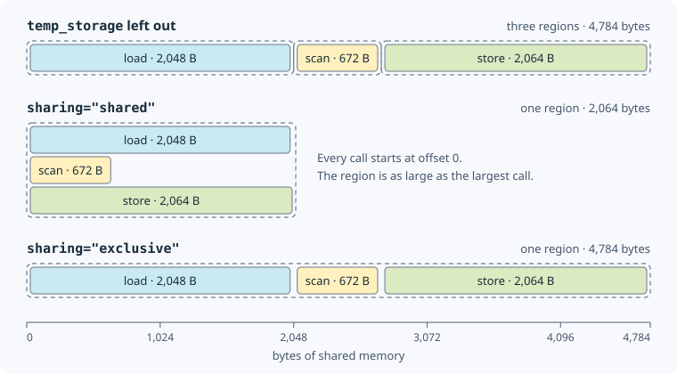

.. Copyright (c) 2026, NVIDIA CORPORATION & AFFILIATES. ALL RIGHTS RESERVED.
..
.. SPDX-License-Identifier: Apache-2.0 WITH LLVM-exception

.. _coop-programming-concepts:
.. _coop-api-namespaces:
.. _kernel-api:

Programming concepts
====================

Cooperative operations let a group of threads work on data together. This
page explains how threads divide a tile, which threads must participate,
and how to use results and temporary storage. The :doc:`Programming Guide
<programming_guide>` provides complete CuTe kernels and launch examples.

.. _coop-concepts-calling-conventions:

Calling conventions
-------------------

A primitive's group and input/output operands precede ``/`` in its
signature and are passed positionally. Controls after ``*`` are keyword-only:

.. code-block:: python

   items = coop.load(
       group, source, items_per_thread=items_per_thread,
       valid_items=count, offset=offset,
   )
   result = coop.reduce(group, items, binary_op="max")

Load always returns a fresh ``ThreadData`` payload. An operation that
returns a new value leaves its input payload unchanged unless its contract
says otherwise. Check :doc:`api` for each operation's accepted operands,
controls, and ownership rules.

Important concepts
------------------

* Single-phase calls: specify a primitive's operands and controls in one
  call inside a CuTe kernel. Compilation specializes the call and determines
  its scratch requirements. See the
  :ref:`complete prefix-sum example <coop-cutlass-load-store>`.
* ``ThreadData`` holds a fixed number of values for each participating
  thread. Load returns a payload whose element type comes from its source;
  other primitives consume or return these per-thread values. See
  :ref:`per-thread payloads <coop-concepts-payloads>`.
* ``TempStorage`` is scratch space in shared memory. Usually you can leave
  it out and the compiler provides the scratch and the barriers. Pass one to
  choose which calls share bytes. See
  :ref:`TempStorage <coop-concepts-storage>`.
* Thread groups identify the participating threads. Use ``this_block()``
  or ``this_warp()`` for block or warp primitives, and query a group's rank
  and size through the thread hierarchy. See
  :ref:`groups and tiles <coop-concepts-groups>`.

Shared execution model
----------------------

.. _coop-concepts-groups:
.. _groups-and-thread-data:

Groups and tiles
^^^^^^^^^^^^^^^^

A group identifies the threads working together. ``this_block()`` selects
the current block; ``this_warp()`` selects a physical 32-thread warp.
``this_warp().group_by(width)`` partitions it into consecutive logical
warps of 1, 2, 4, 8, 16, or 32 threads. A group processing ``K`` items per
thread has a tile of ``group_size * K`` items. Each block or warp group
processes its own tile.

The hierarchy also describes individual threads, clusters, the grid, and mapped
groups of physical warps. These descriptors support queries such as rank,
count, and membership. Their availability does not make every primitive valid
for that group: Reduce, Load/Store, and Scan use block or warp groups, and grid
primitives are unavailable. Consult the backend guide for the supported query
levels and synchronization operations.

A multidimensional block uses x-major linear thread rank:
``x + block_x * (y + block_y * z)``. Warp primitives require an enclosing
block made of complete physical warps. For warp Load/Store, the compiler
adds the group's within-block tile origin to the memory address. A caller's
``offset`` supplies the remaining element offset, such as the block's tile
origin in a larger array; do not add the within-block group origin again.

.. _coop-concepts-participation:
.. _load-and-store-semantics:

Participation and valid prefixes
^^^^^^^^^^^^^^^^^^^^^^^^^^^^^^^^

Every required participant must reach the same primitive invocation.
A short tile does not reduce the number of threads that must participate.
For example, ``valid_items=45`` limits a 64-item Load to its first 45 tile
positions; all threads in the group still call Load. Complete sibling
logical warps may take different paths where the operation's contract
permits it.

For Load and Store, ``valid_items`` counts tile elements, not items per
thread. It must be uniform within the group and lie between zero and the tile
capacity. Clamp a tail count before passing it. Invalid static counts are
rejected during compilation; invalid runtime counts trap on the device.
``offset`` is a nonnegative element offset, also uniform within the group.
It is independent of the valid count. Other families define their own
valid-prefix controls; for example, reduction counts contributing threads.

Load leaves invalid payload slots unspecified unless ``oob_default`` is
provided, even if those slots were initialized before Load. Store leaves
destination elements outside the valid prefix untouched. A valid prefix
controls data access; it does not make it safe to skip a required participant
or a reuse barrier.

.. _coop-concepts-payloads:

Per-thread payloads
^^^^^^^^^^^^^^^^^^^

Prefer ``coop.load(group, source, items_per_thread=items_per_thread)`` for each
participating thread's fixed-size ``ThreadData`` payload. Its element type
comes from ``source``. Pass the positive compile-time count as a kernel
argument declared ``items_per_thread: cutlass.Constexpr`` in both the CuTe
kernel and its launcher. A count of one still returns ``ThreadData``.

Use ``coop.ThreadData(items_per_thread)`` to construct a payload for computed
values or writable auxiliary outputs. Dtype-free construction remains
supported: initialize every consumed item with a compatible typed value.
Load's ``items_per_thread`` and ``alignment`` are keyword-only controls.

Global and shared arrays can supply Load's source and receive Store's output.
Those arrays hold a group tile; a ``ThreadData`` holds one thread's values.
Use native CuTe copies to stage a tile directly in shared memory, then
synchronize before another thread consumes it. See
:ref:`shared-memory staging <coop-shared-load-store>`.

Supported payload dtypes are signed and unsigned 8-, 16-, 32-, and 64-bit
integers and 32- and 64-bit floating-point values. An explicit alignment is
a positive power of two in bytes and sets a minimum when payload storage
is materialized. It does not assert alignment of an input or output array.
For example,
``coop.load(group, source, items_per_thread=items_per_thread, alignment=16)``
requests at least 16-byte alignment for the returned payload, as does
``coop.ThreadData(items_per_thread, alignment=16)`` for a directly constructed
payload. ``None`` lets the compiler choose; it may use stronger alignment.

The payload extent is a compile-time value available as
``items.items_per_thread``. Directly constructed slots start uninitialized.
Initialize every item an operation will read; Load without
``oob_default`` leaves invalid slots unspecified. Assign those slots after
Load before reading them, or supply a default. As in CUB, transpose Store
algorithms may rearrange the input payload in place. Copy values before
Store if they are needed later.

Typing protocols describe the supported payload interfaces; protocol
compatibility alone does not make an arbitrary Python object a kernel value.
CuTe register tensors and immutable ``TensorSSA`` values have explicit
adapters. Typed assignments and supported producers can establish the element
type. See :ref:`element-type inference <coop-faq-thread-data-dtype>` and
:ref:`register and producer conversions <coop-cutlass-register-payloads>`
for ownership, lifetime, and runtime-control-flow rules.

.. _coop-concepts-layouts:
.. _exchange-semantics:
.. _shuffle-semantics:
.. _scan-semantics:

Layouts and operation order
^^^^^^^^^^^^^^^^^^^^^^^^^^^

In a :term:`blocked` layout, each thread owns consecutive tile positions.
In a :term:`striped` layout, consecutive threads own consecutive positions
at each item slot. The :ref:`layout glossary <coop-glossary-layouts>` gives
the formulas and an ownership table.

Load/Store's ``direct`` and ``vectorize`` algorithms expose blocked
payloads. ``striped`` exposes striped payloads. Transpose algorithms use
striped memory accesses and present blocked payloads to the caller.
Exchange converts between supported layouts. ``ThreadData`` does not carry
a layout tag that automatically fixes a mismatched Load/Store pair.
Shuffle shifts values within a block's tile. The
:doc:`Exchange <visualizations/exchange>` and
:doc:`Shuffle <visualizations/shuffle>` visualizations show the
supported rearrangements.

Scan traverses the group's values in blocked tile order. A striped Load
must therefore be converted before a Scan intended to follow the array's
original order. Choosing a memory-access algorithm and choosing the order
of values seen by an operation are related but distinct decisions.

.. _coop-concepts-results:

Result ownership
^^^^^^^^^^^^^^^^

A primitive's return type does not say which threads may use its result.
Reduce/Sum define their result only at group rank zero. Scan returns each
thread's part of the prefix sequence. Check the operation's group and algorithm
contract before consuming a result.

Sorting and selection operate on one group's tile. Sorting each block does not
sort a whole array. TopK defines an unordered selected prefix; the remaining
payload positions are not output. See the :doc:`API reference <api>`
for sorting and selection operations.

.. _coop-concepts-storage:
.. _temporary-storage:

TempStorage
^^^^^^^^^^^

Some primitives need scratch space in shared memory. Leave ``temp_storage``
out and the compiler provides it, with a barrier after each call. Pass a
``TempStorage`` to choose which calls share bytes. This prefix sum shares one
region among its three calls. Load and Store ask for ``algorithm="transpose"``
because their default algorithm uses no scratch:

.. literalinclude:: ../../../python/cuda_coop_cutlass/tests/runtime/test_concepts_documentation.py
   :language: python
   :start-after: # cutlass-concept-temp-storage-begin
   :end-before: # cutlass-concept-temp-storage-end

         Load, Scan and Store each have their own region. With a shared
         TempStorage, all three start at offset 0 of one region as large as
         the largest call. With an exclusive TempStorage, they sit end to
         end in one region.
   :width: 100%

   Scratch for the three calls above, to scale, on a block of 128 threads
   with four ``Int32`` items each: 4,784 bytes left out, 2,064 shared, 4,784
   exclusive. Sizes vary with the block shape, the element type and the CUB
   version.

The kernel above is the middle row: one region the size of its largest call.
Without the three ``temp_storage`` arguments it is the top row.
``sharing="exclusive"`` gives the bottom row, where no call reuses another
call's bytes, so no barrier is needed between them. ``auto_sync=True`` keeps
a barrier after each call. Without it you place the barriers yourself with
``scratch.sync()``. :ref:`TempStorage <coop-temp-storage>` in the API
reference shows how, and covers ``reserve`` and ``release``.
