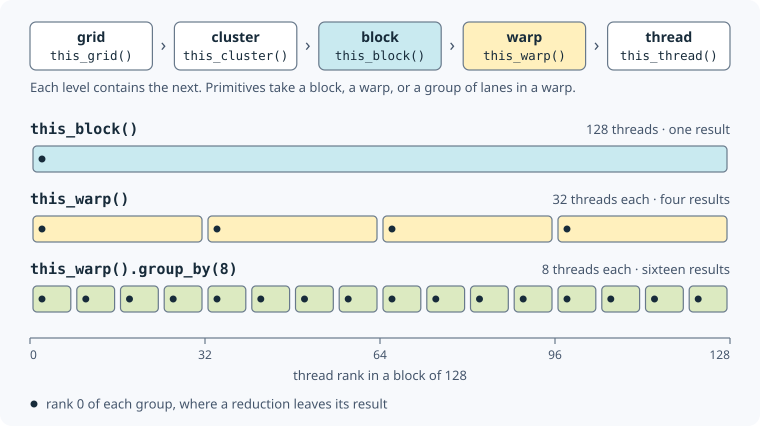
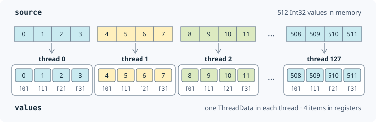

.. Copyright (c) 2026, NVIDIA CORPORATION & AFFILIATES. ALL RIGHTS RESERVED.
..
.. SPDX-License-Identifier: Apache-2.0 WITH LLVM-exception

.. _coop-programming-concepts:
.. _coop-api-namespaces:
.. _kernel-api:

Programming concepts
====================

A cooperative primitive is one call that a group of threads makes together.
Four things appear in every kernel that uses one: the call, the thread group,
each thread's data, and scratch space in shared memory. This page introduces
each with an example. The :doc:`API reference <api>` has the complete rules.

.. _coop-concepts-single-phase:

Single-phase calls
------------------

A primitive is called in one step, inside the kernel:

.. literalinclude:: ../../../python/cuda_coop_cutlass/examples/prefix_sum.py
   :language: python
   :start-after: docs: start cutlass-prefix-sum
   :end-before: docs: end cutlass-prefix-sum

CUB's C++ classes take two steps. The same kernel first specializes a class
for each primitive, repeating the element type, the block size and the items
per thread, and declares the scratch the scan needs. Then it calls them:

.. code-block:: cpp

   __global__ void prefix_sum(const int* source, int* destination)
   {
     using BlockLoad  = cub::BlockLoad<int, 128, 4>;
     using BlockScan  = cub::BlockScan<int, 128>;
     using BlockStore = cub::BlockStore<int, 128, 4>;
     __shared__ typename BlockScan::TempStorage temp_storage;

     int values[4];
     BlockLoad().Load(source, values);
     BlockScan(temp_storage).InclusiveSum(values, values);
     BlockStore().Store(destination, values);
   }

In the Python kernel, each of those facts has one source:

* The block size, 128, comes from ``launch(grid=1, block=128)``.
* The element type comes from the pointer the host passes as ``source``,
  made with ``make_ptr(cutlass.Int32, ...)``.
* The four items per thread come from ``items_per_thread``.
* The scratch comes from the compiler.

:ref:`The top of the API reference <cuda_coop-module>` describes how every
primitive is called.

.. _coop-concepts-groups:
.. _groups-and-thread-data:

Thread groups
-------------

The first argument of a primitive names the threads that make the call
together. One ``sum`` works on a block, on each warp, and on each group of
eight lanes:

.. literalinclude:: ../../../python/cuda_coop_cutlass/tests/runtime/test_concepts_documentation.py
   :language: python
   :start-after: # cutlass-concept-groups-begin
   :end-before: # cutlass-concept-groups-end

         with block and warp filled. Below them, one block of 128 threads
         is drawn as one group, as four warps, and as sixteen groups of
         eight lanes. A dot marks rank 0 of each group.
   :width: 100%

   The three groups of the kernel above, on its block of 128 threads.

Every thread of a group makes the call, and a reduction leaves its result in
the thread with rank 0. A group also answers ``rank`` and ``count``, and
``sync`` is its barrier. :ref:`Thread groups <coop-thread-groups>` in the
API reference lists the groups each primitive takes.

.. _coop-concepts-payloads:

ThreadData
----------

A ``ThreadData`` holds one thread's items, a fixed number of values in
registers. ``load`` returns one in each thread:

         each run of four cells to a card for one thread, from thread 0 to
         thread 127. Each card holds those four numbers as items 0 to 3.
   :width: 100%

   ``values = coop.load(block, source, items_per_thread=4)`` on a block of
   128 threads.

Other primitives read a payload and return a new one, and ``store`` writes
one to memory. A kernel can fill a payload itself. This one squares the
items it loaded and sums the squares:

.. literalinclude:: ../../../python/cuda_coop_cutlass/tests/runtime/test_concepts_documentation.py
   :language: python
   :start-after: # cutlass-concept-thread-data-begin
   :end-before: # cutlass-concept-thread-data-end

The number of items is fixed when the kernel is compiled, so an index is a
Python integer or a ``cutlass.range_constexpr`` variable. :ref:`ThreadData
<coop-thread-data>` in the API reference covers element types, ``from_fn``,
and conversion to and from CuTe register tensors.

.. _coop-concepts-storage:
.. _temporary-storage:

TempStorage
-----------

Some primitives need scratch space in shared memory. Leave ``temp_storage``
out and the compiler provides it, with a barrier after each call. Pass a
``TempStorage`` to choose which calls share bytes. This prefix sum shares one
region among its three calls. Load and Store ask for ``algorithm="transpose"``
because their default algorithm uses no scratch:

.. literalinclude:: ../../../python/cuda_coop_cutlass/tests/runtime/test_concepts_documentation.py
   :language: python
   :start-after: # cutlass-concept-temp-storage-begin
   :end-before: # cutlass-concept-temp-storage-end

.. figure:: visualizations/concept-temp-storage.svg
   :alt: Three rows of bars on one byte axis. With temp_storage left out,
         Load, Scan and Store each have their own region. With a shared
         TempStorage, all three start at offset 0 of one region as large as
         the largest call. With an exclusive TempStorage, they sit end to
         end in one region.
   :width: 100%

   Scratch for the three calls above, to scale, on a block of 128 threads
   with four ``Int32`` items each: 4,784 bytes left out, 2,064 shared, 4,784
   exclusive. Sizes vary with the block shape, the element type and the CUB
   version.

The kernel above is the middle row: one region the size of its largest call.
Without the three ``temp_storage`` arguments it is the top row.
``sharing="exclusive"`` gives the bottom row, where no call reuses another
call's bytes, so no barrier is needed between them. ``auto_sync=True`` keeps
a barrier after each call. Without it you place the barriers yourself with
``scratch.sync()``. :ref:`TempStorage <coop-temp-storage>` in the API
reference shows how, and covers ``reserve`` and ``release``.

.. _coop-concepts-calling-conventions:

Calling conventions
-------------------

In a signature, the group and the operands come before ``/`` and are passed
by position. Controls come after ``*`` and are passed by keyword:

.. code-block:: python

   items = coop.load(
       group, source, items_per_thread=items_per_thread,
       valid_items=count, offset=offset,
   )
   result = coop.reduce(group, items, binary_op="max")

``items_per_thread`` and ``binary_op`` select code, so they are Python
values, fixed when the kernel is compiled. ``valid_items`` and ``offset``
describe data and can also be CuTe values computed while the kernel runs.
The call can sit in the kernel or in a ``@cute.jit`` function that the
kernel calls.

Rules every kernel follows
--------------------------

.. _coop-concepts-participation:
.. _load-and-store-semantics:

Participation
^^^^^^^^^^^^^

Every thread of the group makes the call. ``valid_items`` shortens the data
and leaves the group whole: with ``valid_items=45``, a Load of 64 elements
reads the first 45, and every thread of the group still calls ``load``.

The count is in elements of the group's :term:`tile`, from zero to the
tile's size, and is the same for every thread of the group. A Python count
outside that range is rejected when the kernel is compiled. A runtime count
outside it traps on the device.

.. _coop-concepts-layouts:
.. _exchange-semantics:
.. _shuffle-semantics:
.. _scan-semantics:

Layouts
^^^^^^^

A payload has a layout, set by the call that made it. In a :term:`blocked`
layout each thread holds neighboring elements of the tile. In a
:term:`striped` layout, neighboring threads hold neighboring elements. The
:ref:`glossary <coop-glossary-layouts>` has a table of both.

Load and Store with the same ``algorithm`` agree on the layout, and
:doc:`Exchange <visualizations/exchange>` converts one into the other. A
scan reads values in blocked order, so a kernel that loads with
``algorithm="striped"`` converts the payload before it scans.

.. _coop-concepts-results:

Results
^^^^^^^

A result belongs to particular threads. ``reduce`` and ``sum`` leave their
result in the thread with rank 0. A scan gives each thread its own part of
the running result. A sort orders one group's tile, so sorting each block of
a grid leaves the array as a whole unsorted. Each entry in the
:doc:`API reference <api>` says where its result is defined.
