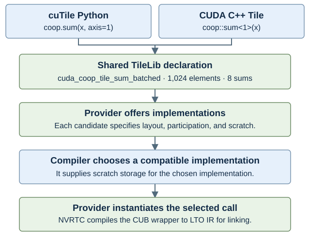

.. Copyright (c) 2026, NVIDIA CORPORATION & AFFILIATES. ALL RIGHTS RESERVED.
..
.. SPDX-License-Identifier: Apache-2.0 WITH LLVM-exception

Developer guide
===============

``cuda.coop.tile`` connects logical Tile operations to CUB implementations
through a native linkage provider. The Python and C++ interfaces share
the foreign-call declarations and provider artifact. Their public value
representations and lowering code differ.

This guide follows a sum through those layers and describes the checks
needed when changing them. The :doc:`Python </tile/python/programming>` and
:doc:`C++ </tile/cpp/programming>` guides cover application kernels.

Following a sum
---------------

Take an eight-row matrix with 128 columns. Each row sum reduces 128
elements. The two frontends use the same provider operation to compute
eight sums, then give those sums their language's result shape.

   On CUDA 13.5 the provider scores implementations during discovery.

In Python, ``coop.sum(x, axis=1)`` returns shape ``(8,)``.
``sum_impl`` normalizes the options and ``_reduce_impl`` arranges the
input into batches. Here the reduction axis is already last, so the
lowering flattens the matrix and passes 1,024 items and eight batches
to ``cuda_coop_tile_sum_batched``. The preview call also carries an
effect token used by the compiler. The public result contains the data.

In C++, ``coop::sum<1>(x)`` returns shape ``<8, 1>``. The public
header derives the same batch dimensions at compile time and calls the
generated foreign declaration. The header reshapes the eight sums to
retain axis one with extent one.

The shared declaration describes the input and output sizes explicitly:

.. literalinclude:: ../../tile/cpp/tilelib/interface/cuda_coop_tile.mlir
   :language: text
   :start-at: cuda_tile.preview$func extern @cuda_coop_tile_sum_batched<
   :end-before: cuda_tile.preview$func extern @cuda_coop_tile_reduce_batched<
   :dedent: 2

``N`` counts all input elements. ``Batches`` counts output elements.
The provider and compiler choose the implementation for this logical call.

Source map
----------

.. list-table::
   :header-rows: 1
   :widths: 42 58

   * - Source
     - Responsibility
   * - ``python/cuda_coop_tile/cuda/coop/tile/``
     - Lazy Python exports, compiler markers, and registration.
   * - ``python/cuda_coop_tile/cuda/coop/tile/_lowerings.py``, ``_block/``, ``_dispatch.py``
     - Python call validation and conversion to preview foreign calls.
   * - ``tile/cpp/include/cuda/coop/tile.cuh``
     - Public C++ overloads, typed policies, and calls to generated foreign
       declarations.
   * - ``tile/cpp/tilelib/interface/cuda_coop_tile.mlir``
     - Canonical declarations, constant parameters, Tile types, and operand
       access annotations.
   * - ``tile/cpp/tilelib/coop_linkage_provider.cpp``
     - Implementation discovery with early filtering and scoring, followed
       by selected-call instantiation.
   * - ``tile/cpp/tilelib/provider/``
     - Request binding, validated implementation specifications, family
       semantics, source emission, compilation, and caches.
   * - ``python/cuda_coop_tile/`` and ``tile/cpp/cmake/``
     - Installed artifact resolution, Python packaging, and CMake
       consumption.

Binding requests before selecting implementations
-------------------------------------------------

``provideImpls`` finds the operation family and binds a ``LogicalRequest``
before enumerating candidates. The request contains the logical shape,
operation options, dtype tokens, target, and Exchange's semantic width.
Ordinary declarations contain no ``BlockThreads`` or ``ItemsPerThread``
constants. Run Length Decode declares its run and decoded extents rather
than separate items-per-thread quantities.
Malformed declarations receive a diagnostic even when no physical thread
count divides the requested extent.

CUDA 13.5 does not invoke ``filter_and_rank``. The provider therefore filters
candidates and assigns their preference scores in ``provideImpls`` (the
``provide_impls`` callback). Each admitted catalog row declares a concrete
candidate width and fragment layout. Its score combines the base score with
the operation family's existing topology preference.

Discovery does not know the final worker count of the enclosing kernel.
Candidate admission uses the logical request, target, and operation's
constraints; the compiler selects among the advertised implementations.
Exchange's explicit width remains fixed because it defines the permutation.
Run Length Decode retains separate run and decoded extents. For a candidate
worker count that divides both extents, the provider derives runs and decoded
items per thread from those extents. These distinctions belong in request
binding, before resource queries or emitted source can collapse them.

Candidate selection constructs an ``ImplementationSpec`` with validated
concrete topology. Only that type proceeds to code generation, resource
probes, and artifact caches. Its fields are read-only to consumers.
Family code owns supported dtypes, algorithms, and topology restrictions;
the generated declaration schema owns ABI structure.

Instantiation rebinds the compiler's resolved call and checks the
implementation identity, target, execution scope, and final worker
constraints. If another compiler invokes ``filter_and_rank``, that callback
retains its resolved-call validation without adding the early preference
score a second time. Neither discovery nor instantiation depends on that
optional callback. A failed binding does not leave a partially populated
request for later compilation. Preserve these checks when adding a new
operation or changing the compiler adapter.

Scratch, source generation, and compilation
-------------------------------------------

Each family emits a CUB wrapper for the validated specialization. Resource
queries use the concrete generated wrapper to determine its scratch
requirements. During discovery, the provider uses NVRTC to compile size
and alignment probes for candidates whose requirements are absent from
its cache. The compiler allocates the advertised temporary memory and
passes it to the selected implementation.

Instantiation validates the full batch before probing resources or invoking
NVRTC. It checks the selected implementations against the resolved target
and resource budget, combines the required wrappers, and compiles their
device code into an LTO-IR module. The module supplies the symbols selected
by the compiler.

The runtime owns each NVRTC program until its output or diagnostic has been
copied. A guard destroys the program on success and on early failure. The
returned module owns its LTO-IR bytes and symbol strings through the linkage
SDK. A cache hit copies bytes into that module's independent buffer, so cache
eviction does not invalidate a module already returned to the compiler.
Compiler callsite views borrow input records only for the callback; retained
requests own their validated values.

Keep compilation errors and cleanup tests together when changing this
lifecycle.
Successful provider compilation is one step: runtime tests must also link
the generated implementation into an actual Tile kernel and check its
output.

Cache boundaries
----------------

Each native provider instance caches resource estimates and compiled bundles.
Keys identify the validated implementation, target, explicit cache epoch, and
ordered include paths. Signed dtype and topology remain part of the
implementation identity. A separate seen-artifact set records trace history;
a hit in that set alone does not mean compiled bytes were reused.

The provider copies cache values under a mutex and performs NVRTC compilation
after releasing it. Concurrent misses can compile the same input more than
once. Resource queries group misses by identical include-path order and
reuse one result for duplicate specializations.

Keys do not hash compiler binaries or header contents. If a development build
changes those inputs at the same paths, start a new provider instance or
change ``CUDA_COOP_TILE_PROVIDER_CACHE_EPOCH``. This does not invalidate a
frontend cache that returns an already compiled kernel before invoking the
provider.

Python's preview-call cache also needs the TileLib identity described in
:doc:`/tile/interop`. Its version/hash contract is separate from the provider's
internal keys. When measuring compilation, record which cache was enabled
and whether the provider actually ran.

The provider's optional development controls include
``CUDA_COOP_TILE_PROVIDER_CACHE_EPOCH`` and entry limits
``CUDA_COOP_TILE_PROVIDER_SEEN_CACHE_ENTRIES``,
``CUDA_COOP_TILE_PROVIDER_BUNDLE_CACHE_ENTRIES``, and
``CUDA_COOP_TILE_PROVIDER_RESOURCE_CACHE_ENTRIES``. The default entry limits
are 4096, 128, and 512 respectively. A nonzero limit clears the whole cache
before an insertion once it is full; it does not evict the least recently used
entry. Zero makes that cache unbounded. Use
``CUDA_COOP_TILE_PROVIDER_NVRTC_COMPILE_COUNTER_FILE`` to record bundle
compilations alongside provider traces during a focused reproduction.

Changing a declaration or adding a primitive
--------------------------------------------

Edit ``tile/cpp/tilelib/interface/cuda_coop_tile.mlir`` first when the ABI
changes. It generates the private C++ declarations, Python declaration
schemas, and native provider schema tables. From the repository root:

.. code-block:: bash

   python tile/tools/generate_tile_declarations.py
   python tile/tools/generate_tile_declarations.py --check

Generated files are checked in so ordinary consumers do not need Python
to generate C++ declarations. The generator rejects unsupported types and
attributes; extending it requires an explicit supported representation.
TileIR integer types are signless, so preserve the dtype-token constants
used to distinguish signed and unsigned provider implementations.

After defining the ABI, add family binding and capability checks, source
emission, and the public language interfaces. Validate invalid inputs as
well as accepted calls. Compare generated declarations, Python lowerings,
and C++/native metadata against an independent ABI expectation. A test
that reads back the same generated table cannot detect an incorrect table.

Finish with GPU result checks, installed consumers, and the relevant
reference/tutorial changes. Document only the language surfaces actually
implemented in both Python and C++.

Building and installing
-----------------------

The native CMake entry point is ``tile/``. It builds the provider and packages
its declarations and implementation into ``cuda_coop_tile.tilelib``. Supply
``CUDA_COOP_TILE_SDK_ROOT`` for the separate interoperation SDK,
``CUDA_COOP_TILE_INTERFACE_TRANSLATOR`` for ``cuda-tile-translate``, and
``CUDAToolkit_ROOT`` for the CUDA 13.5 toolkit. SDK headers and sources stay
outside the source and installed payloads; the build compiles SDK support
code into the provider. Missing build inputs fail configuration.
Build ``cuda-tile-translate`` from the public `CUDA Tile v13.5.0 release
<https://github.com/NVIDIA/cuda-tile/releases/tag/v13.5.0>`_ matching CUDA 13.5;
the declaration build emits TileIR bytecode version 13.5.

The :doc:`C++ installation guide </tile/cpp/installation>` gives the standalone
build and install commands. The :doc:`Python installation guide
</tile/python/installation>` passes the same native inputs through the wheel
build. Both consume the same provider source and declaration interface.

Focused validation
------------------

Run tests from ``python/cuda_coop_tile`` in the configured environment:

.. code-block:: bash

   python -m pytest tests/backends/tile_python/lowering
   python -m pytest tests/backends/tile_cpp/compile
   python -m pytest tests/backends/tile_python/runtime/test_scan.py \
       tests/backends/tile_python/runtime/test_reduce.py
   python -m pytest tests/backends/tile_cpp/runtime/test_frontend_abi.py
   python -m pytest tests/integration/examples/test_tile_examples.py \
       tests/backends/tile_python/runtime/test_topk.py::test_cuda_coop_tile_executes_mma_row_topk_pipeline
   python -m pytest tests/integration/packaging
   python -m pytest tests/integration/docs

Select runtime tests for each changed primitive. Compiler tests require the
provider and frontend toolchain; runtime tests also require a supported GPU.
Inspect skips and failures rather than treating collection as execution.

Validate installed artifacts outside the source checkout. Include a relocated
wheel installation and a standalone CMake consumer so source-relative paths
cannot hide missing payloads. A shared native change needs both Python and
C++ consumers. Check numerical results, input preservation, and compositions
that exercise compatible worker counts.

From the repository root, build the documentation with its requirements installed:

.. code-block:: bash

   ./docs/gen_docs.bash

The first kernels in the Python and C++ guides come from the downloadable
examples. Edit those sources when a call changes. The primitive references
also contain executable examples. The tests in
``python/cuda_coop_tile/tests/integration/docs/`` check Python signatures
against the frontend and its type stub, resolve source excerpts, and
compile or run the examples with their language toolchains.

When changing a result shape, update its language reference and the
corresponding figure in ``docs/tile/visualizations/``. When changing how
a sum reaches CUB, check the compiler diagram above against both frontends
and the shared declaration. Inspect the built page to verify that its
excerpts, downloads, and diagrams still show the relevant code.

Implementation selection
------------------------

CUDA 13.5 filters and scores candidates in ``provideImpls``. Check the
advertised scores and the implementation selected for compilation alongside
numerical results. This compiler does not invoke ``filter_and_rank``; host
callback tests still cover its validation for compilers that do.

A compiler's acceptance of a worker hint does not guarantee a compatible
provider implementation for every logical shape. Each call in a kernel must
admit the chosen participation. Test small extents and explicit worker hints
when changing topology selection. Measure the complete kernel before making
performance claims.
