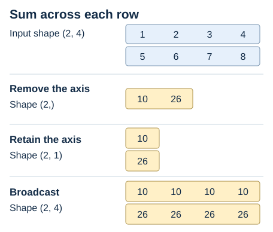

.. Copyright (c) 2026, NVIDIA CORPORATION & AFFILIATES. ALL RIGHTS RESERVED.
..
.. SPDX-License-Identifier: Apache-2.0 WITH LLVM-exception

Programming model
=================

A cooperative call takes a Tile with a known element type and shape and
returns a new Tile or a pair of Tiles. To write a kernel, choose which
partition each block loads, what the call computes within that partition,
and which result positions to store.

.. _tile-array-partitions:

Shapes and array partitions
---------------------------

The :doc:`Python scan example </tile/python/programming>` partitions an array
of 512 counts into two tiles of 256. The load and store take a *tile
coordinate*. In C++, a partition view uses the same convention.

.. list-table:: Two blocks scanning one array
   :header-rows: 1

   * - Logical block
     - Array positions
     - Exclusive sum at the start of the partition
   * - 0
     - 0 through 255
     - ``output[0] = 0``, ``output[1] = input[0]``
   * - 1
     - 256 through 511
     - ``output[256] = 0``, ``output[257] = input[256]``

Block 1 passes coordinate ``1`` to the load. The load accounts for the
256-element partition width. A scan over the entire array would also need
the sum of the preceding partitions. Each cooperative call sees only the
values its block supplies.

Logical blocks and physical threads
-----------------------------------

In Python the grid passed to ``ct.launch`` counts logical blocks, and
``ct.bid(0)`` selects a partition. In C++, launch with
``kernel<<<logical_blocks, 1>>>(...)`` and select the partition with
``ct::bid().x``. The trailing ``1`` is the C++ Tile launch sentinel.

The compiler assigns the logical values to physical workers. For example,
a 256-element tile can put several elements in each thread. A kernel worker
hint constrains this choice for all calls in the kernel. A collective can
use a subset of the kernel's workers. See :doc:`the advanced Python guide
</tile/python/advanced>` for an example where the worker count matters.

Inputs and results
------------------

A scan produces one prefix per input position. A reduction can produce
many fewer values. For a one-dimensional input of 128 values, choose a
result shape that fits the next operation:

.. list-table::
   :header-rows: 1

   * - Result
     - Python
     - C++
   * - One aggregate
     - ``coop.sum(x)`` has shape ``()``. Pass ``keepdims=True`` for shape ``(1,)``.
     - ``coop::sum<0>(x)`` retains axis zero with extent one.
   * - A tile of 128 copies of the aggregate
     - ``coop.sum(x, broadcast=True)``
     - ``coop::sum(x)``

   In Python, ``coop.sum(matrix, axis=1)`` gives the vector. Pass
   ``keepdims=True`` for the column, or ``broadcast=True`` for the matrix.
   C++'s ``coop::sum<1>(matrix)`` gives the column.

To subtract each row's sum from its inputs, retain the reduced axis so
the column lines up with the rows during subtraction. The reduction
references cover accepted axes, dtype promotion, and floating-point
behavior in :doc:`Python </tile/python/primitives/reduce>` and
:doc:`C++ </tile/cpp/primitives/reduce>`.

Other operations take one-dimensional inputs. Pair sorting returns keys and
payloads in corresponding positions. Histogram returns one counter per bin.
Run Length Decode returns the requested number of decoded positions. Its
input run count and output capacity can differ. The
:doc:`data-flow diagrams </tile/visualizations/index>` illustrate each result.

.. _tile-multirow-reduction-workaround:

CUDA 13.5 multirow reductions
^^^^^^^^^^^^^^^^^^^^^^^^^^^^^

On SM120, CUDA 13.5.37 can generate an out-of-bounds shared-memory store
when it lays out the results of a multirow warp reduction. This occurs, for
example, when summing the rows of an ``8 × 128`` float32 tile in C++.
Compute Sanitizer reports the invalid store even when the kernel returns
the expected sums in an ordinary run.

For affected row sums, use ``coop.sum(matrix, axis=1, algorithm="raking")``
in Python. In C++, pass ``coop::reduce_policy<coop::reduce_algorithm::raking>{}``
as the second argument to ``coop::sum<1>``.

Compile-time choices and runtime controls
-----------------------------------------

Shape and dtype are fixed when the kernel compiles. The same TopK kernel
can take a different ``k`` at each launch. It returns a tile with the input
capacity, and only the first ``min(k, valid_items)`` positions hold selected
values. Their order is unspecified. The :doc:`Python
</tile/python/primitives/topk>` and :doc:`C++ </tile/cpp/primitives/topk>`
references give the accepted scalar and Tile forms.

Partial tiles
-------------

Suppose the last input partition holds 200 samples in a tile of 256.
Loading 56 zeros into the remaining positions preserves a sum. Passing
that same tile to Histogram adds 56 counts to bin zero. Where the
operation accepts ``valid_items``, pass the number of meaningful elements.

In Python, pass ``padding_mode=ct.PaddingMode.ZERO`` to ``ct.load`` for
zero padding. Keep the default bounds checks on ``ct.store`` so it writes
only the part of the last tile that overlaps the output array. Launch one
block per nonempty partition. The :ref:`MMA and TopK example
<tile-python-mma-topk>` combines a padded load with a valid candidate count.

In C++, build the partition view over the actual array extent. For the
partial partition, ``view.load_masked(index)`` pads out-of-range elements
with zero by default. ``view.store_masked(result, index)`` writes only
the positions inside the view.

Exchange topology defines the permutation
-----------------------------------------

Exchange is an operation for which the number of participating threads
changes the values you get back. Python takes a compile-time
``block_threads``. C++ takes an ``exchange_policy<BlockThreads>``.
For a 256-element input ``x``, follow the first few elements as you
change the width of a striped-to-blocked exchange:

.. tab-set::

   .. tab-item:: 128 threads

      Each thread owns two items. Thread 0 gathers input positions 0 and
      128. Thread 1 gathers positions 1 and 129. The output starts with
      ``[x[0], x[128], x[1], x[129]]``.

   .. tab-item:: 256 threads

      Each thread owns one item. Thread 0 takes position 0, thread 1
      takes position 1, and so on. The output starts with
      ``[x[0], x[1], x[2], x[3]]``.

In general, for extent ``N`` and thread count ``B``, each thread owns
``I = N / B`` items. The permutation and its inverse are

.. code-block:: text

   striped_to_blocked: y[t * I + i] = x[i * B + t]
   blocked_to_striped: y[i * B + t] = x[t * I + i]

Use the same width for the inverse. The :doc:`Python
</tile/python/primitives/exchange_shuffle>` and
:doc:`C++ </tile/cpp/primitives/exchange_shuffle>` references give the
allowed widths and show the element mapping.

Temporary storage and composition
---------------------------------

A cooperative result can feed another Tile operation in the same kernel.
The provider reports the scratch required by each CUB specialization.
The compiler allocates it, and the collective handles its own internal
synchronization. A composition needs a compatible worker configuration for
every call and enough resources for the whole kernel. See
:ref:`the two-stage TopK example <tile-python-mma-topk>` for a composition
and :doc:`/tile/interop` for provider traces.

.. _tile-radix-capacity:

.. rubric:: Radix scratch capacity

Radix Sort and Rank use scratch space that grows exponentially with
``radix_bits`` (``RadixBits`` in C++). A supported bit count can exceed
the available memory for a particular worker count or GPU. Reducing the
bit count reduces this storage requirement.
