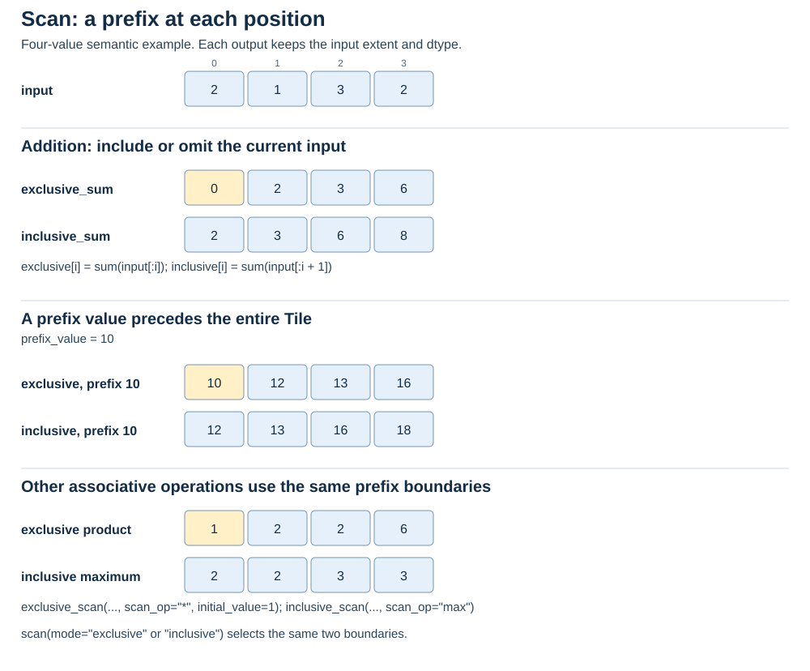
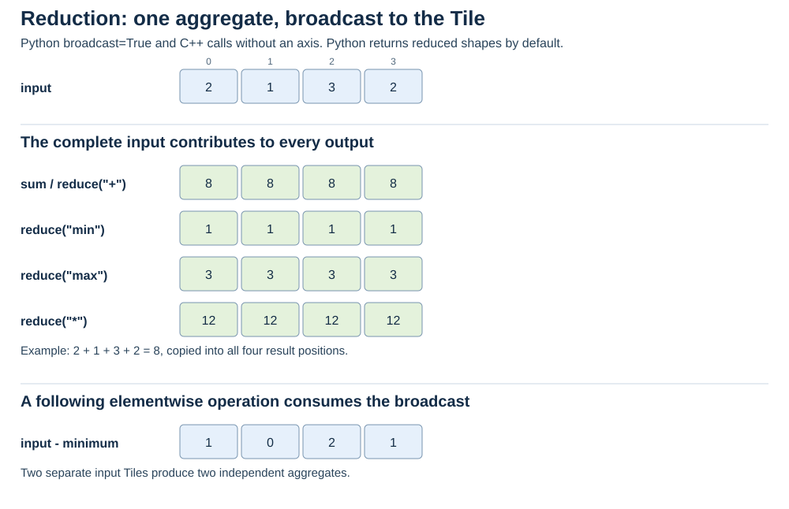
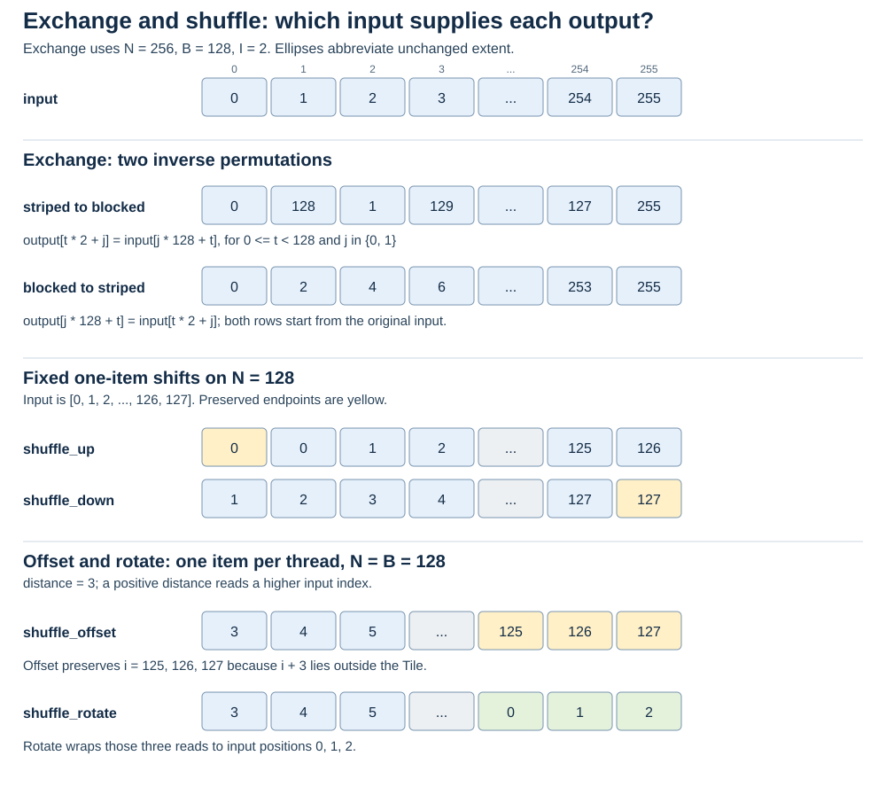
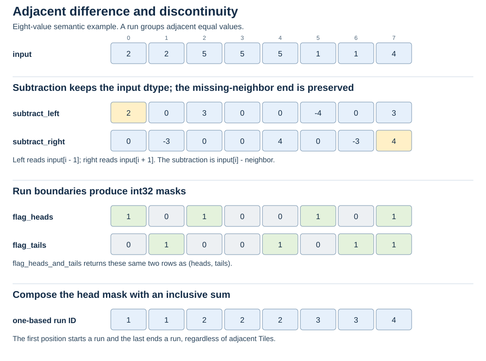
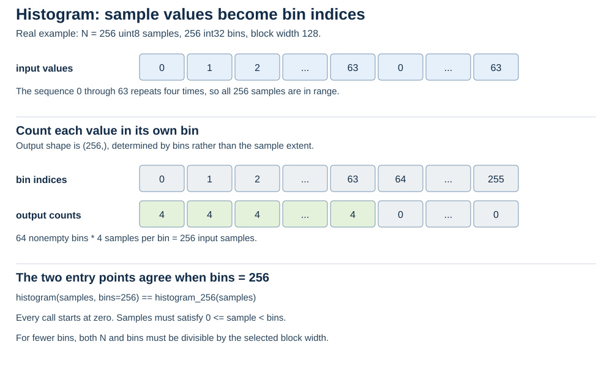
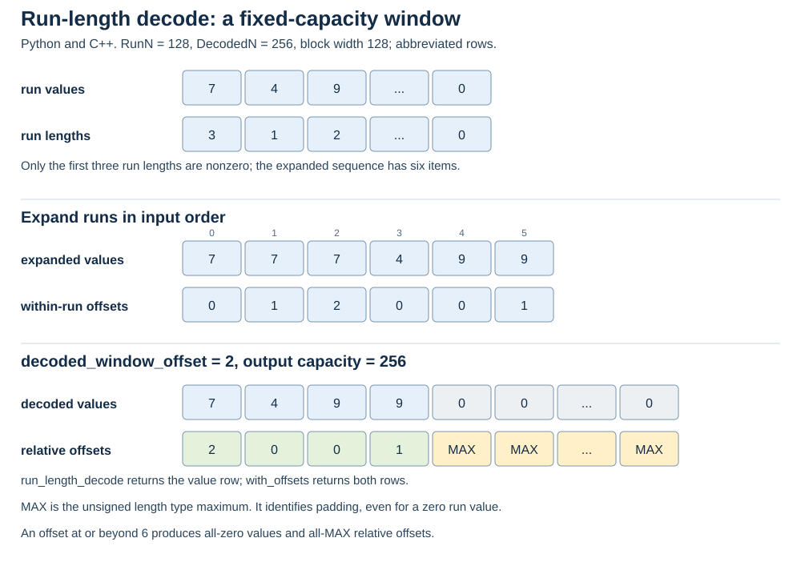
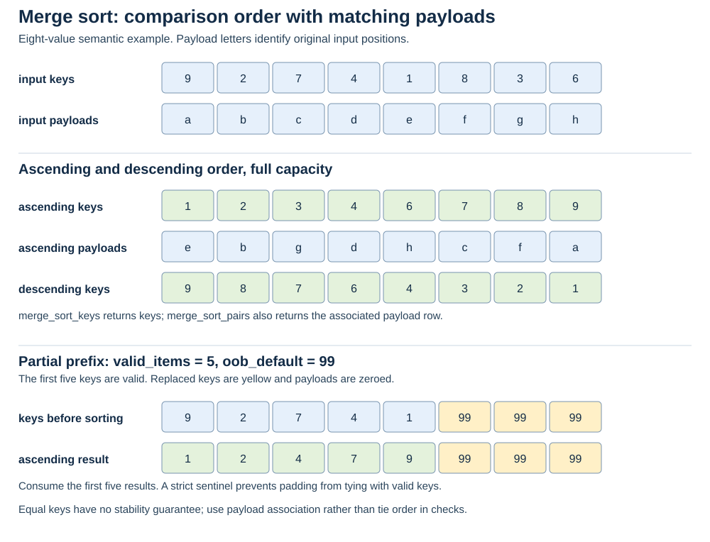
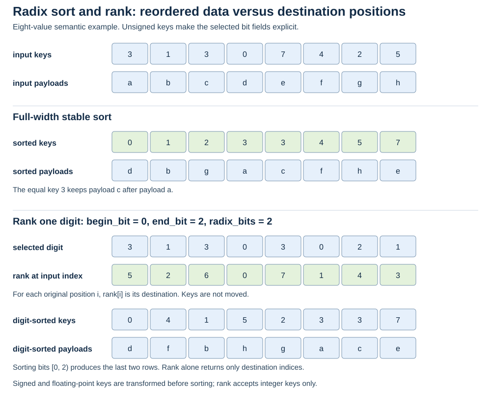
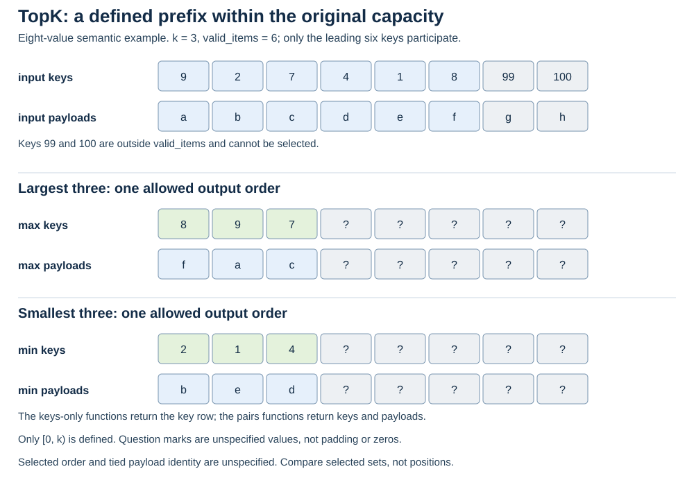

.. Copyright (c) 2026, NVIDIA CORPORATION & AFFILIATES. ALL RIGHTS RESERVED.
..
.. SPDX-License-Identifier: Apache-2.0 WITH LLVM-exception

Tile data-flow diagrams
=======================

These diagrams show logical positions in a Tile. They do not depict compiler
register layouts. Exchange, histogram, and run-length decode use the actual
extents in their executable examples; ellipses abbreviate those rows. Other
diagrams use small semantic examples to make every value visible. Their
reference pages provide runnable 128- or 256-element kernels.

Prefixes and reduction
----------------------

   Each prefix has a different endpoint. An initial or prefix value supplies
   the value before the first input. See :doc:`Python </tile/python/primitives/scan>` and
   :doc:`C++ </tile/cpp/primitives/scan>`.

   Python ``broadcast=True`` and C++ reductions without an axis repeat the
   aggregate at every input position. Python reductions return only the
   aggregates by default; C++ axis overloads preserve rank with an extent of
   one on the reduced axis. See :doc:`Python </tile/python/primitives/reduce>` and
   :doc:`C++ </tile/cpp/primitives/reduce>`.

Movement and neighbors
----------------------

   Exchange uses an explicit block width to define the permutation. Offset
   preserves out-of-range destinations; rotation wraps them.
   See :doc:`Python </tile/python/primitives/exchange_shuffle>` and
   :doc:`C++ </tile/cpp/primitives/exchange_shuffle>`.

   Discontinuity compares adjacent values and marks runs. An inclusive sum
   of the head mask numbers those runs. See
   :doc:`Python </tile/python/primitives/adjacent_discontinuity>` and
   :doc:`C++ </tile/cpp/primitives/adjacent_discontinuity>`.

Counts and decoded windows
--------------------------

   Histogram output extent is the bin count. Each byte sample selects one
   bin to increment. See :doc:`Python </tile/python/primitives/histogram>` and
   :doc:`C++ </tile/cpp/primitives/histogram>`.

   Decode output extent is the requested capacity. Relative offsets count
   within each run and mark padding with the unsigned maximum. See
   :doc:`Python </tile/python/primitives/run_length_decode>` and
   :doc:`C++ </tile/cpp/primitives/run_length_decode>`.

Ordering and selection
----------------------

   Padding keys sort after the meaningful prefix when the caller selects a
   suitable sentinel. See :doc:`Python </tile/python/primitives/merge_sort>` and
   :doc:`C++ </tile/cpp/primitives/merge_sort>`.

   Rank is indexed by the original input position. Sorting returns keys in
   the selected digit order. See :doc:`Python </tile/python/primitives/radix_sort_rank>` and
   :doc:`C++ </tile/cpp/primitives/radix_sort_rank>`.

   Only the first ``min(k, valid_items)`` outputs are defined. Their order and
   tied payload identity are unspecified. See :doc:`Python </tile/python/primitives/topk>` and
   :doc:`C++ </tile/cpp/primitives/topk>`.
