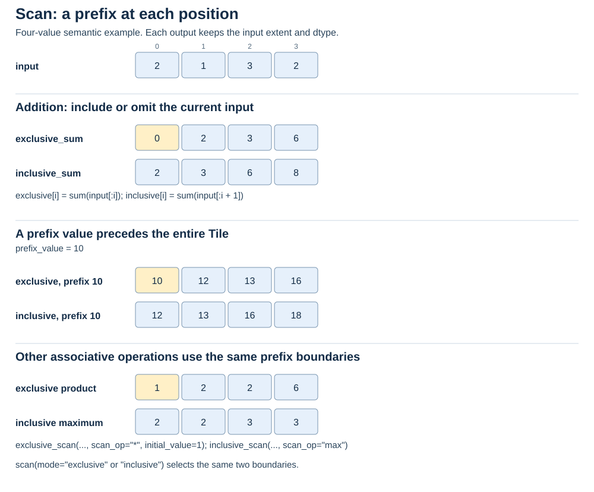
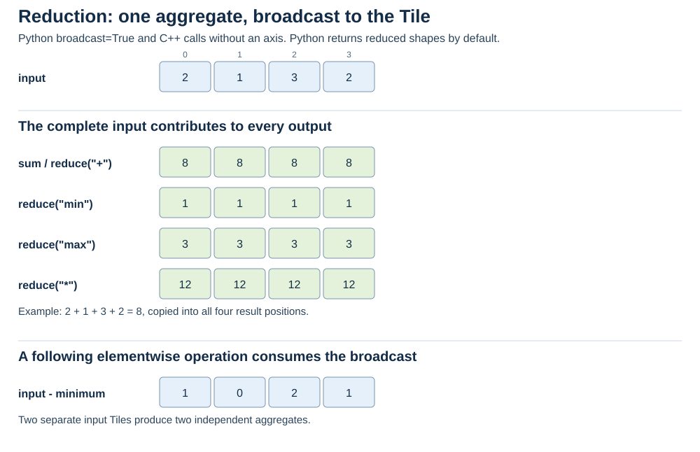
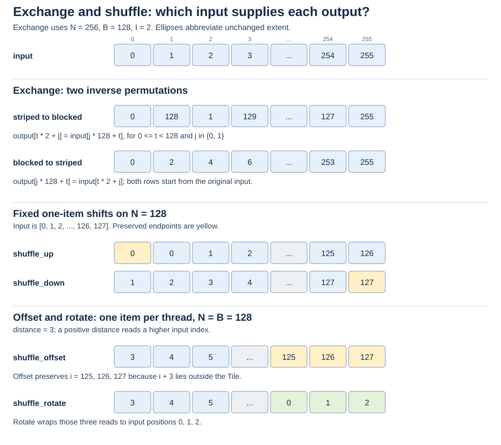
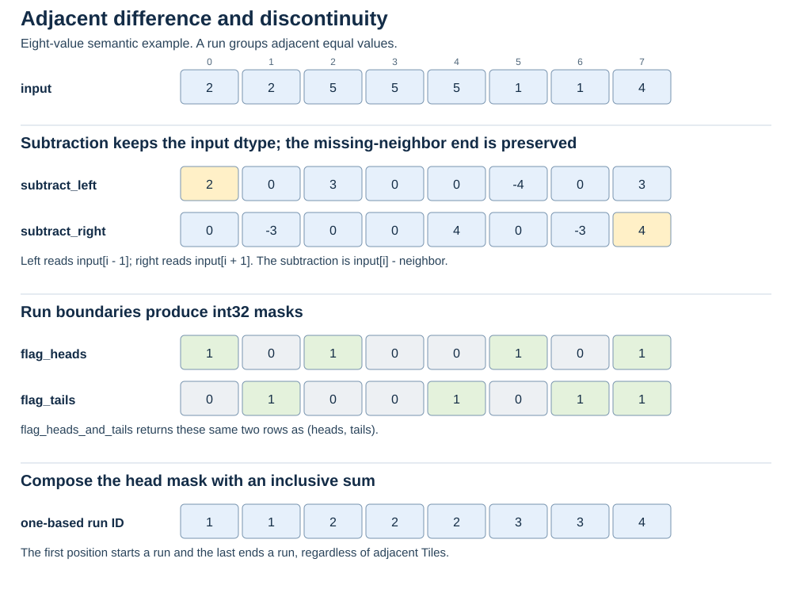
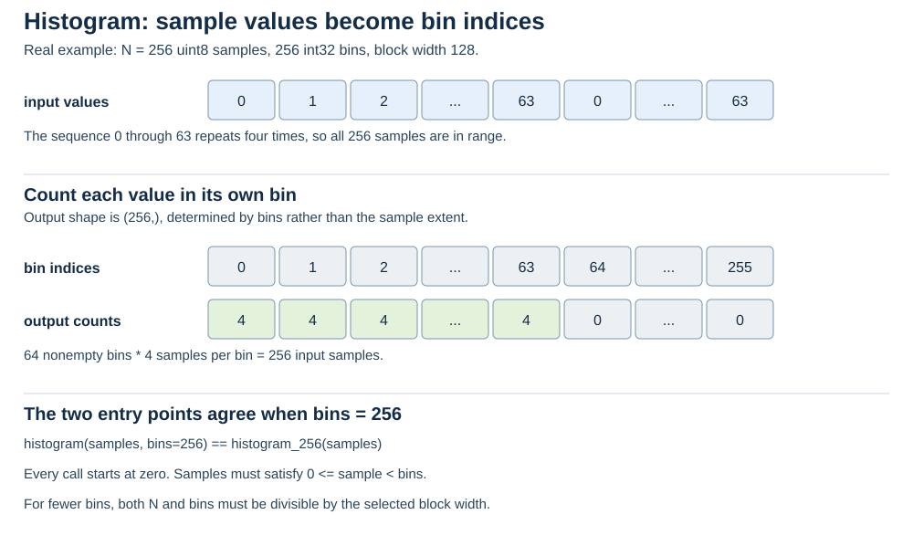
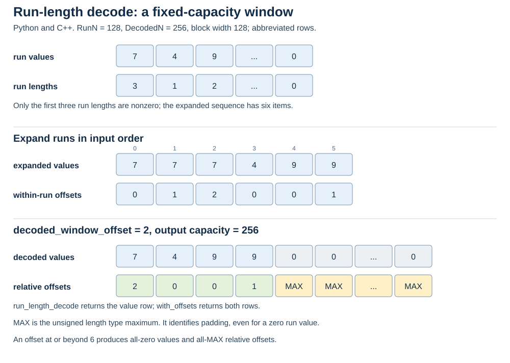
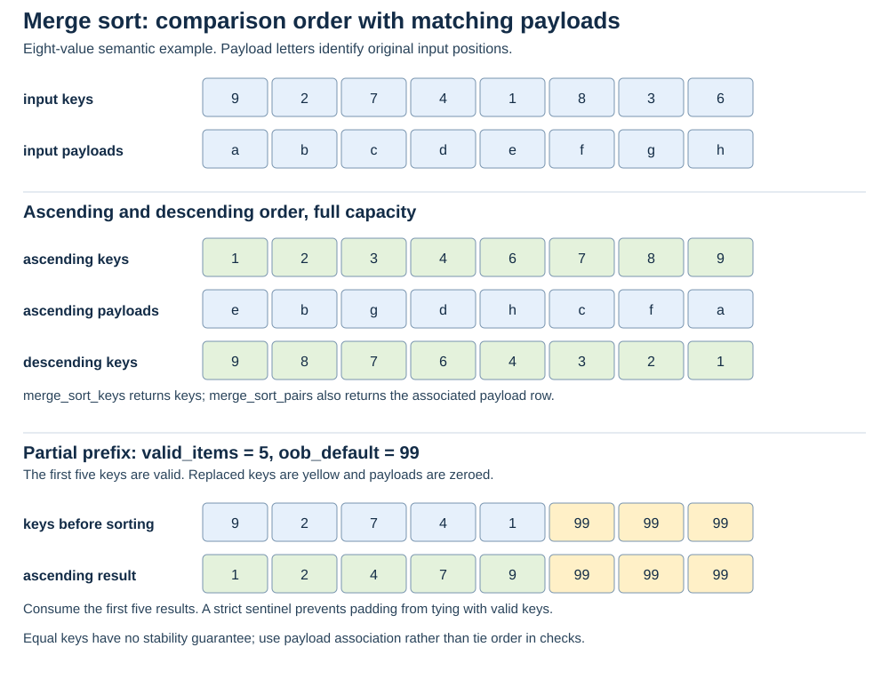
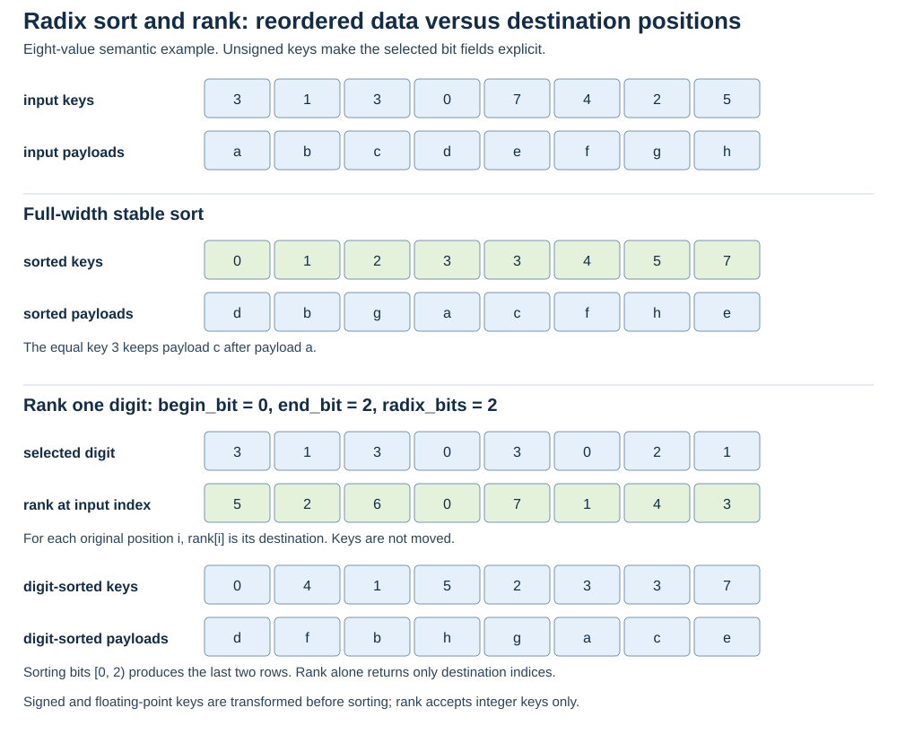
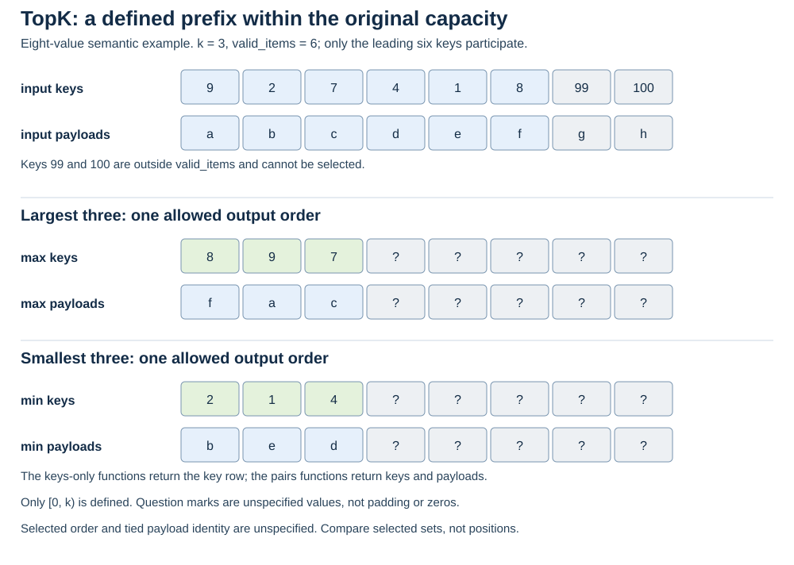

.. Copyright (c) 2026, NVIDIA CORPORATION & AFFILIATES. ALL RIGHTS RESERVED.
..
.. SPDX-License-Identifier: Apache-2.0 WITH LLVM-exception

Tile data-flow diagrams
=======================

Read each row from left to right as positions in a logical Tile. Exchange,
Histogram, and Run Length Decode show the extents from the executable
examples, with ellipses for omitted positions. The other figures use
small inputs so you can follow every value. Each caption links to the
language references. Links to CUB describe the underlying primitives.

Prefixes and reduction
----------------------

   Each prefix has a different endpoint. An initial or prefix value supplies
   the value before the first input. See :doc:`Python </tile/python/primitives/scan>` and
   :doc:`C++ </tile/cpp/primitives/scan>`.
   The block scan uses :cpp:class:`cub::BlockScan`.

   Python ``broadcast=True`` and C++ reductions without an axis repeat the
   aggregate at every input position. Python reductions return only the
   aggregates by default; C++ axis overloads preserve rank with an extent of
   one on the reduced axis. See :doc:`Python </tile/python/primitives/reduce>` and
   :doc:`C++ </tile/cpp/primitives/reduce>`.
   Depending on the reduction shape, the provider can use
   :cpp:class:`cub::WarpReduceBatched`, :cpp:class:`cub::WarpReduce`,
   or :cpp:class:`cub::BlockReduce`.

Movement and neighbors
----------------------

   Exchange uses an explicit block width to define the permutation. Offset
   preserves out-of-range destinations; rotation wraps them.
   See :doc:`Python </tile/python/primitives/exchange_shuffle>` and
   :doc:`C++ </tile/cpp/primitives/exchange_shuffle>`.
   The provider implements these movements with :cpp:class:`cub::BlockExchange`
   and :cpp:class:`cub::BlockShuffle`.

   Discontinuity compares adjacent values and marks runs. An inclusive sum
   of the head mask numbers those runs. See
   :doc:`Python </tile/python/primitives/adjacent_discontinuity>` and
   :doc:`C++ </tile/cpp/primitives/adjacent_discontinuity>`.
   The corresponding CUB primitives are :cpp:class:`cub::BlockAdjacentDifference`
   and :cpp:class:`cub::BlockDiscontinuity`.

Counts and decoded windows
--------------------------

   Histogram output extent is the bin count. Each byte sample selects one
   bin to increment. See :doc:`Python </tile/python/primitives/histogram>` and
   :doc:`C++ </tile/cpp/primitives/histogram>`.
   The provider counts the samples with :cpp:class:`cub::BlockHistogram`.

   Decode output extent is the requested capacity. Relative offsets count
   within each run and mark padding with the unsigned maximum. See
   :doc:`Python </tile/python/primitives/run_length_decode>` and
   :doc:`C++ </tile/cpp/primitives/run_length_decode>`.
   The underlying CUB primitive is :cpp:class:`cub::BlockRunLengthDecode`.

Ordering and selection
----------------------

   Padding keys sort after the meaningful prefix when the caller selects a
   suitable sentinel. See :doc:`Python </tile/python/primitives/merge_sort>` and
   :doc:`C++ </tile/cpp/primitives/merge_sort>`.
   The provider uses :cpp:class:`cub::BlockMergeSort` or :cpp:class:`cub::WarpMergeSort`
   for the selected implementation.

   Rank is indexed by the original input position. Sorting returns keys in
   the selected digit order. See :doc:`Python </tile/python/primitives/radix_sort_rank>` and
   :doc:`C++ </tile/cpp/primitives/radix_sort_rank>`.
   See :cpp:class:`cub::BlockRadixSort` for sorting and :cpp:class:`cub::BlockRadixRank`
   for assigning each position a rank.

   Only the first ``min(k, valid_items)`` outputs are defined. Their order and
   tied payload identity are unspecified. See :doc:`Python </tile/python/primitives/topk>` and
   :doc:`C++ </tile/cpp/primitives/topk>`.
